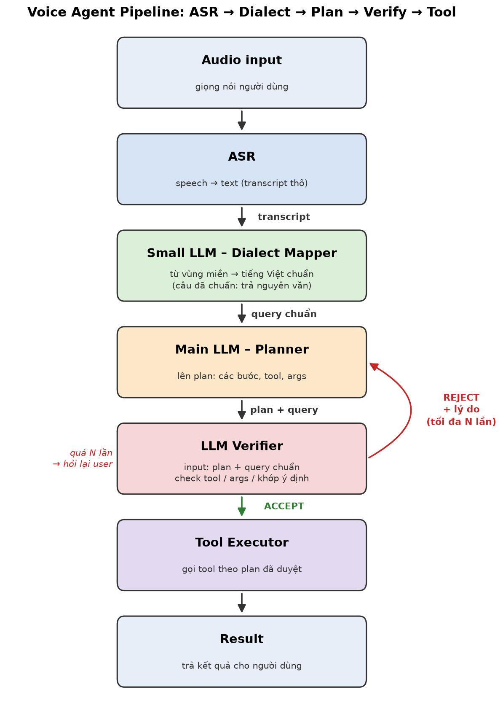
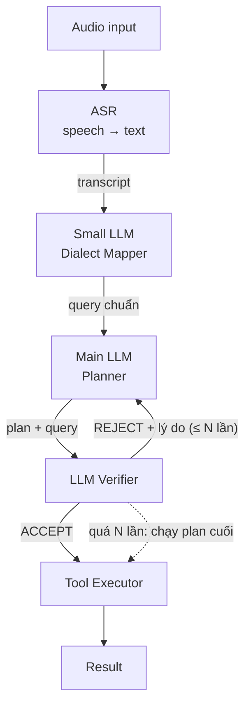
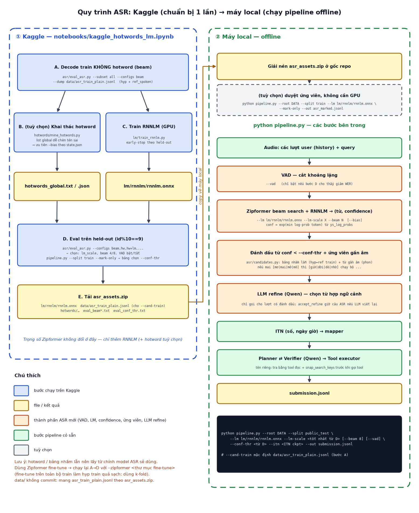

# Voice Agent Pipeline

Pipeline xử lý yêu cầu bằng giọng nói: **ASR → Chuẩn hoá phương ngữ → Lập plan → Verify → Gọi tool**.





---

## 1. Tổng quan luồng

| # | Bước | Input | Output | Model |
|---|------|-------|--------|-------|
| 1 | ASR | Audio | Transcript đã refine | Zipformer + RNNLM, LLM sửa từ conf thấp (mục 4) |
| 2 | Dialect Mapper | Transcript thô | Query tiếng Việt chuẩn | Small LLM |
| 3 | Planner | Query chuẩn | Plan (các bước, tool, args) | Main LLM |
| 4 | Verifier | Plan + query chuẩn | `ACCEPT` / `REJECT` + lý do | LLM (cùng hoặc khác Main LLM) |
| 5 | Tool Executor | Plan đã ACCEPT | Kết quả tool | Code (không phải LLM) |

---

## 2. Chi tiết từng bước

### 2.1 ASR (Automatic Speech Recognition)

ASR chuyển giọng nói thành văn bản, giữ nguyên cách nói của người dùng kể cả từ địa phương.

- Zipformer + RNNLM; từ confidence thấp được LLM sửa theo ngữ cảnh, rồi ITN đổi số / ngày giờ sang dạng viết (mục 4).
- Không chuẩn hoá phương ngữ ở bước này, để Dialect Mapper xử lý tập trung.

### 2.2 Small LLM – Dialect Mapper

Small LLM chuyển từ ngữ vùng miền sang tiếng Việt chuẩn mà không đổi ý nghĩa câu.

- Câu đã chuẩn thì **trả nguyên văn**, nên không cần thêm bước classifier "có phương ngữ hay không".
- Dùng model nhỏ vì đây là tác vụ rewrite đơn giản, cần nhanh và rẻ.
- Chỉ được đổi từ ngữ, không được thêm hay bớt ý (tên riêng, số, ngày giờ phải giữ nguyên).

Ví dụ:

| Transcript thô | Query chuẩn |
|---|---|
| "Mai mấy giờ tàu ra Huế rứa?" | "Ngày mai mấy giờ có tàu ra Huế vậy?" |
| "Đặt cho tui cái lịch họp chiều ni" | "Đặt cho tôi lịch họp chiều nay" |
| "Bật đèn phòng khách" | "Bật đèn phòng khách" *(giữ nguyên)* |

### 2.3 Main LLM – Planner

Main LLM đọc query chuẩn cùng danh sách tool có sẵn rồi lập plan gồm các bước, tool cần gọi và tham số.

Output nên là JSON để Verifier và Executor parse được:

```json
{
  "intent": "tra cứu lịch tàu",
  "steps": [
    {"tool": "search_train", "args": {"to": "Huế", "date": "2026-11-01"}}
  ]
}
```

Khi nhận REJECT, Planner dùng **lý do reject** để sửa plan, không lập lại từ đầu.

### 2.4 LLM Verifier

Verifier nhận **plan + query chuẩn** và kiểm tra plan trước khi cho phép gọi tool.

Các điểm cần check:
1. **Đúng tool:** tool có tồn tại và có phù hợp với ý định của query không.
2. **Đúng args:** đủ tham số bắt buộc, đúng kiểu, giá trị khớp với query (ngày, tên, số).
3. **Khớp ý định:** plan làm đúng việc user yêu cầu, không thừa và không thiếu.
4. **An toàn:** hành động không đảo ngược được (xoá, thanh toán, gửi tin) thì cần user xác nhận.

Output:

```json
{"verdict": "REJECT", "reason": "thiếu args 'date', query nói 'ngày mai'"}
```

### 2.5 Tool Executor

Dựa trên ToolEnv của Ban Tổ Chức
---

## 3. Vòng lặp REJECT

Sau khi Verifier REJECT, plan quay về Planner kèm lý do, **tối đa N lần** (gợi ý N = 2–3).

- Không giới hạn số vòng thì Planner và Verifier có thể lặp mãi, tốn token và tăng độ trễ.
- Quá N lần thì **plan cuối cùng được chạy luôn, không kiểm tra nữa** (code: `plan_step` trong `pipeline.py`).

```
Planner ──plan──► Verifier ──REJECT + lý do──► Planner   (retry ≤ N)
                     │
                     ├── ACCEPT ──► Tool Executor
                     └── quá N lần ──► Tool Executor (plan cuối, không kiểm tra)
```

---

## 4. ASR: Zipformer + RNNLM, đánh dấu từ confidence thấp rồi cho LLM sửa



(Vẽ lại ảnh: `python docs/make_asr_workflow.py`.)

```
Audio ─► [VAD] ─► Zipformer (+RNNLM, [hotword]) ─► [(từ, conf)] ─► đánh dấu conf < ngưỡng + ứng viên ─► LLM sửa ─► ITN ─► mapper ─► planner
```

Zipformer là `hynt/ZipFormer-150M-CR-CTC-RNNT-6000h` chạy bằng sherpa-onnx (`asr/asr_zipformer.py`), hoặc bản fine-tune qua `--zipformer <thư mục>`.

### 4.1 Chuẩn bị trên Kaggle (`notebooks/kaggle_hotwords_lm.ipynb`)

| Bước | Lệnh | Output |
|---|---|---|
| A | `asr/eval_asr.py --subset all --configs beam --dump data/asr_train_plain.jsonl` | `hyp` + `ref_spoken` của mọi lượt train |
| B (tuỳ chọn) | `hotwords/mine_hotwords.py` | `hotwords/hotwords_global.txt` (`--hotwords-file`) |
| C | `lm/train_rnnlm.py` | `lm/rnnlm/rnnlm.onnx` (`--lm`) |
| D | `asr/eval_asr.py --configs beam,hw,hw+lm,...`, `pipeline.py --split train --mark-only` | chọn `--lm-scale`, `--beam`, `--vad`, `--conf-thr` |
| E | zip | `asr_assets.zip`: rnnlm.onnx, asr_train_plain.jsonl, hotwords, bảng eval |

### 4.2 Các bước trong `pipeline.py`

1. **Confidence theo từ** (`transcribe(..., words=True)`): sherpa-onnx trả `ys_log_probs` cho từng token BPE. Token gộp
   thành từ, conf của từ = `exp(log-prob nhỏ nhất)` trong các token của nó.
2. **Ứng viên** (`asr/candidates.py`, `Candidates.from_train`): học từ `--cand-train` (mặc định
   `data/asr_train_plain.jsonl` của bước A, bỏ held-out `id % 10 == 9`):
   - bảng nhầm lẫn: căn `hyp` với `ref_spoken`, đếm cặp thay thế 1-1 (giữ cặp gặp ≥ 2 lần);
   - từ gần âm trong từ vựng train theo `hotwords.bias.phon` (bỏ dấu, gộp s/x, ch/tr, d/gi/r...), giống âm hơn và hay gặp hơn xếp trước.
3. **Đánh dấu**: từ có conf < `--conf-thr` được viết thành `[từ ASR|ứng viên 1|ứng viên 2|...]`, ví dụ
   `nếu mai [mơ|mai|mở|mô] thì [giờ|dời|dò|nhờ] chạy bộ ...`. Lượt không có từ nào bị đánh dấu thì không gọi LLM.
4. **LLM sửa** (`REFINE_SYSTEM`, dùng `--llm`): mỗi chỗ đánh dấu giữ từ cũ, chọn ứng viên, hoặc chọn từ gần âm khác hợp
   ngữ cảnh; trả chữ thường, số dạng chữ. Kèm tối đa 2 lượt trước làm ngữ cảnh. `accept_refine` giữ câu ASR nếu LLM trả
   rỗng, còn ngoặc, lệch số từ nhiều hoặc viết lại phần lớn câu.
5. **ITN** chạy trên câu đã sửa, rồi mapper → planner ⇄ verifier → tool.
6. **Snap search key** (`snap_search_keys`, `SEARCH_KEYS`): trước khi gọi tool, tham số tên (`contacts.search`,
   `tv.*`...) được đổi về tên có thật trong app của mẫu (theo phát âm). Ghi trong trace (`snap`).

Tham số: `--conf-thr` (mặc định 0.6), `--cand-k` (mặc định 3), `--bias` (hotword từ user_profile + tool call/kết quả trong history của item, không đọc state.json),
`--hotwords-file` (hotword cố định từ bước B), `--vad`, `--lm`, `--lm-scale`, `--beam`.
Trace ghi `{"refine": {"marked", "to"}}`.

```bash
# chọn --conf-thr: chỉ đánh dấu, không LLM/GPU -> in WER ASR + bảng (% đánh dấu, % từ sai bắt được, precision)
python pipeline.py --root DATA --split train --lm lm/rnnlm/rnnlm.onnx --mark-only --limit 300
# chỉ phần âm thanh, có LLM refine -> in WER trước / sau refine
python pipeline.py --root DATA --split train --lm lm/rnnlm/rnnlm.onnx --no-llm --limit 200
# cả pipeline
python pipeline.py --root DATA --split public_test --lm lm/rnnlm/rnnlm.onnx --itn ITN_CKPT
```

Bảng ngưỡng đo trước đây (150 câu held-out train, Zipformer beam, chưa có hotword/LM), cần đo lại với LM:

| `--conf-thr` | từ bị đánh dấu | từ sai bắt được | precision |
|---|---|---|---|
| 0.5 | 10.9% | 29.7% | 43.4% |
| 0.6 | 17.4% | 41.2% | 37.6% |
| 0.7 | 24.2% | 52.0% | 34.0% |

Giới hạn:
- Từ bị ASR bỏ sót không có confidence nên không đánh dấu được.
- Ứng viên chỉ lấy từ từ vựng train: tên riêng mới (danh bạ, kênh của từng mẫu) để planner tra bằng tool đọc, và
  `snap_search_keys` chạy trước khi gọi tool.
- Một số ứng viên còn thiếu ("mơ" không ra "mưa"); prompt cho phép LLM tự chọn từ gần âm ngoài danh sách.
- `--text` bỏ qua ASR và refine; `--llm gold` chỉ đánh dấu, không gọi LLM.
